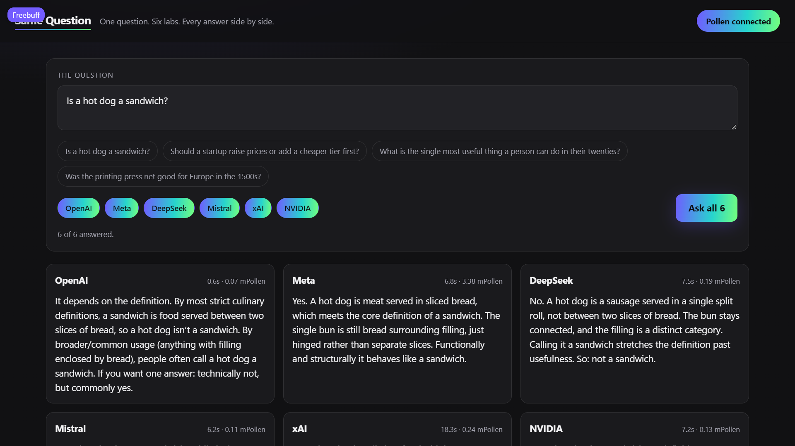

[](https://pollinations.ai/?ref=badge)

# Same Question

Ask one question to models from six different labs at once, read every answer side by side, then
see exactly where they split. Live app: **https://rekty.github.io/same-question/**



Pollinations serves text, image and audio models from many labs behind one key. Asking two labs the
same question is cheap; asking six and reading the answers next to each other is the only way to
tell which parts of an answer come from the question and which come from the model. Built for
[quest #19183](https://github.com/pollinations/pollinations/issues/19183).

## What the app does

- **Six labs, one click.** OpenAI, Meta, DeepSeek, Mistral, xAI and NVIDIA answer the same
  prompt in parallel. All six are free models (`paid_only: false` on `GET /models`, health
  `healthy` when last checked on 2026-11-15), so a visitor on free Pollen still gets six answers. Any two to six can be toggled; the question is sent verbatim with one shared
  system prompt that caps the answer at 90 words.
- **Every answer stands alone.** Each card keeps its own text, latency and the Pollen it actually
  cost, computed from the token usage the API returns and the per-token prices in
  `GET /models`. Nothing is merged into a fake consensus.
- **Blind vote first.** The answers are shuffled and labelled A–F, with no lab name, latency or cost
  on screen. You pick the answer you rate; only then are all six unblinded, the pick is marked, and a
  tally of the blind votes you have cast in this browser is shown. The tally lives in `localStorage`
  — there is no account, no server, and no one else's votes are mixed in.
- **Where they split.** A local grouping pass compares the answers by shared vocabulary (Jaccard
  over content words, union-find at a fixed threshold), so the camps cost nothing and are
  reproducible from the text alone.
- **Name the camps.** One optional `gpt-5.4-nano` call reads the finished answers and gives each
  camp a two- or three-word label ("strict no (typical)", "broad yes (definition)"). The judge
  never sees the question's expected side, only the answers.
- **Shareable question.** `Copy link` puts the question and the chosen models in the URL hash. The
  answers are not in the link, because they cost the next reader their own Pollen.

## Paying for it

The app is static files; there is no backend and no key of the maintainer's. Readers connect
through the device flow of
[Bring your own Pollen](https://github.com/pollinations/pollinations/blob/main/BRING_YOUR_OWN_POLLEN.md):
the token lands in that tab's `sessionStorage`, is only ever sent to `gen.pollinations.ai`, and
signing out clears it. Pasting an `sk_` key directly is also supported for people who already have
one.

## Tests

```bash
node --test        # 13 tests over the grouping maths and the blind-vote tally
```

The tested modules, `shared/agree.js` and `shared/blind.js`, are pure: tokenising, Jaccard similarity,
union-find grouping, the shape-of-the-result line, mapping judge labels back onto answers, the
shuffle, the A–F letters and the vote tally. UI wiring is not covered
by tests; the app was exercised against the live API with a real device-flow session.

## Run locally

```bash
python -m http.server 8091   # any static server; no build step
```

Files: `index.html`, `style.css`, `app.js`, `shared/pollen.js` (device flow + one chat call),
`shared/agree.js` (grouping), `shared/blind.js` (shuffle, letters, vote tally),
`test/agree.test.mjs`, `test/blind.test.mjs`.
